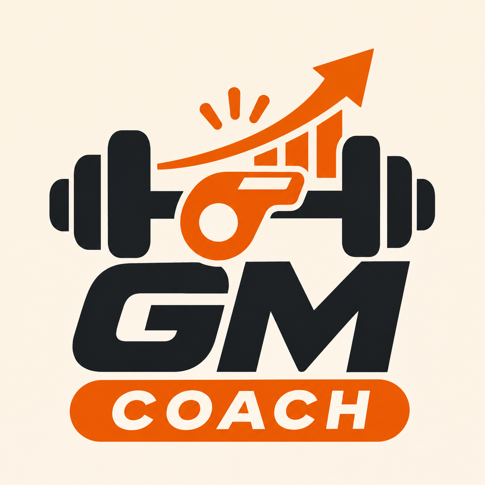
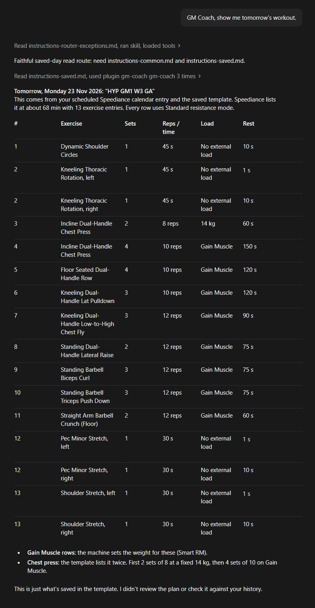
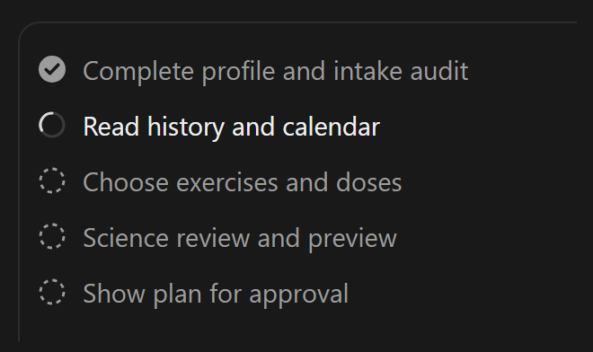
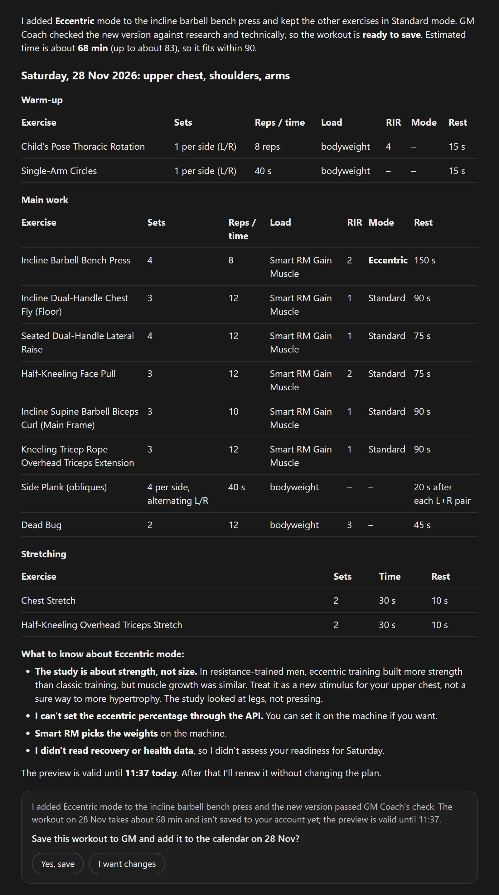

<p align="center">
  
</p>

<h1 align="center">GM Coach</h1>

<p align="center">
  An AI coaching plugin for the Speediance Gym Monster. It plans strength training in Codex, ChatGPT and Claude from your own workout history and current research.
</p>

<p align="center">
  <b>English</b> · <a href="README.pl.md">Polski</a>
</p>

<p align="center">
  <a href="#install-with-one-command"><b>Install with one command (Codex / Claude)</b></a>
</p>

<p align="center">
  <a href="https://github.com/gmcoach-plugin/gmcoach/releases/latest"></a>
  <a href="LICENSE"></a>
  <a href="https://ko-fi.com/gmcoach"></a>
</p>

<p align="center">
  
</p>

## Features

### Planning

- **Training plans:** creates Gym Monster programs for strength, timed exercises and cardio, using only exercises and accessories you confirm, with a matching warm-up and stretching.
- **Multi-week cycles:** plans progression and deloads week by week, with dates, and saves the whole cycle after one approval.
- **Smart RM and resistance modes:** uses the Gain Muscle, Stamina and Strength presets and the Standard, Chain and Eccentric modes, or a fixed load suggested from your 1RM.
- **Editing saved workouts:** changes rest, resistance mode, load or exercise order and shows the differences before saving.
- **Calendar:** reads your Speediance calendar and schedules saved workouts on chosen days.
- **Session length:** estimates how long a workout takes and fits the plan to the time you have.

### Analysis and recovery

- **Workout history:** reads completed sessions with sets, loads, heart rate, rowing data and period statistics.
- **Session comparison:** compares two completed sessions set by set.
- **Recovery data:** reads Speediance health reports such as sleep, HRV, fatigue and muscle load, with your permission.

### Personal coaching

- **Training profile:** a short interview records your goals, preferences and limitations locally.
- **Injury-aware plans:** takes reported movement limitations into account.
- **Equipment:** checks your accessories and what each exercise needs, and searches the Gym Monster exercise catalogue.
- **Research-backed decisions:** searches PubMed and links real sources to plan decisions.

### More

- **Official content:** browses official Speediance workouts and programs.
- **Plan sharing and import:** exports a plan or a saved workout to a file, and imports shared plans and workout JSON files. Every imported exercise and dose is checked before anything is saved.
- **Quick test workout:** creates a one-off test session to try an exercise or setting.
- **Multiple accounts:** supports several Speediance profiles on one computer.
- **Template limit:** detects a full template list and suggests unused templates to remove, only with your approval.
- **Diagnostics:** checks the plugin version and the connection to your Speediance account.

### Safety and privacy

- **Safe writes:** shows a full preview of every plan and saves it to your account only after your explicit confirmation.
- **Interrupted saves:** if a save is interrupted, GM Coach checks your account before trying again, which prevents duplicate workouts. A multi-week cycle continues from where it stopped.
- **Local memory:** remembers facts you ask it to keep, such as equipment or preferences, and forgets them when you ask.
- **Local and private:** runs on your computer, and your Speediance password stays in the system password store.

## How it works

GM Coach works through clear steps and shows its progress while it prepares a plan:

<p align="center">
  
</p>

When the plan is ready, GM Coach shows the full workout, explains its choices and waits for your approval before saving:

<p align="center">
  
</p>

## What's new in 1.0.692

- **One-command install** in Codex and Claude (see [Install with one command](#install-with-one-command)).
- **%1RM in Smart RM:** the percentage is chosen automatically for your goal, shown on every set, can differ between sets of one exercise, and is kept in import and export.
- **Warm-ups:** Smart RM is used for warm-ups from 50% 1RM; lighter warm-ups use Customize.
- **Techniques:** warm-up with weight, supersets and drop sets are added only when they help your goal or your time.
- **Health data:** GM Coach asks once whether to use your Speediance health data, and the health report is improved (body measurements, sleep with stages, night heart rate, biological age).
- **Resistance modes:** a hint for choosing Eccentric and Chain modes.
- **Faster plan creation.**
- **Updaters:** a small package updates the plugin without downloading everything again.

## How progression works

GM Coach plans progression from your own history, week by week, and checks it against research before anything is saved.

- **Week to week:** each week can change reps, sets, load or %1RM. The plan shows every change and compares each week with the previous working week.
- **RIR (reps in reserve):** the planned number of reps you should leave in the tank, from 0 to 5. It is set separately from the reps and is not used for timed sets.
- **Automatic %1RM in Smart RM:** the percentage comes from reps plus RIR (for example 10 reps at RIR 2 gives 70%) and is kept inside the preset range: Gain Muscle 50–90%, Stamina 50–70%, Strength 50–90%. You can set a different percentage for a set, with a short reason.
- **Deload:** a deload week must reduce the planned dose compared with a working week, and its automatic %1RM is never higher than the baseline week's. Its timing is chosen for you individually, not fixed to a calendar.
- **Your history:** loads and sets come from your completed sessions, read only with your permission. Without history, GM Coach asks instead of guessing.
- **Health data (optional):** GM Coach asks once per conversation whether to use your Speediance health data. If you decline, it plans from your history and your own feedback.
- **Science check:** every real plan goes through a research check before saving, unless you turn it off for that plan.

## Supported apps

| App | Platform | Installation guide |
|---|---|---|
| Codex (optionally ChatGPT through a secure tunnel) | Windows; macOS and Linux experimental | [English](installer/codex/README-INSTALL-EN.md) · [Polski](installer/codex/README-INSTALACJA.md) |
| Claude (desktop app and Claude Code) | Windows; macOS and Linux experimental | [English](installer/claude/README-CLAUDE-EN.md) · [Polski](installer/claude/README-CLAUDE.md) |

## Install with one command

Requires [Node.js 24](https://nodejs.org/). Run the commands for your app, then open a new chat.

**Codex**

```
codex plugin marketplace add gmcoach-plugin/gmcoach
codex plugin add gm-coach@gm-coach
```

**Claude**

```
claude plugin marketplace add gmcoach-plugin/gmcoach
claude plugin install gm-coach@gm-coach
```

On first start GM Coach downloads its helper files (checked with SHA-256) into a per-user folder. No tunnel is needed; a tunnel is only used for ChatGPT.
## Quick start

1. Download the installer for your app from the [latest release](https://github.com/gmcoach-plugin/gmcoach/releases/latest).
2. Optionally, compare the file's SHA-256 checksum with the one shown in the release.
3. Extract the whole archive and run `START-WINDOWS.cmd` (Codex) or `START-CLAUDE-WINDOWS.cmd` (Claude).
4. Open a new chat and write: *"GM Coach, help me connect my Speediance account."*

You need a Speediance account and a Gym Monster. See the installation guide for macOS, Linux, updates and uninstalling.

**Tested devices:** Tested on GM1 and GM2. GM3: experimental, not yet tested.

## Updating

Use the updater for your app: [Codex](installer/updater/codex/README-UPDATE-EN.md) · [Claude](installer/updater/claude/README-CLAUDE-UPDATE-EN.md) (all files are in [installer/updater](installer/updater)). The updater is a small package and does not download everything again. Tested on Windows; macOS and Linux are experimental.

## Manual installation (advanced)

Prefer to install GM Coach as a plain plugin without the installer? See [manual installation](plugin/INSTALL.md).

## Privacy and security

- Your Speediance password is stored only in your operating system's credential store (Windows Credential Manager, macOS Keychain or Linux Secret Service). Never share it in a chat.
- The plugin reads your history and changes your account only after you allow it in the conversation.
- Any dependencies the installers download come from official sources and are verified with checksums.

## Reporting bugs and requesting features

Use [GitHub Issues](https://github.com/gmcoach-plugin/gmcoach/issues/new/choose). Include the plugin version from the local diagnostics, and do not post passwords, e-mail addresses, tokens or keys.

## Support the project

GM Coach is free. If it helps your training, you can [support it on Ko-fi](https://ko-fi.com/gmcoach).

## License

Released under the [MIT License](LICENSE).

## Disclaimer

GM Coach is an independent project and is not affiliated with, endorsed by or sponsored by Speediance. Gym Monster and Speediance are trademarks of their respective owners. The training suggestions do not replace advice from a qualified coach or medical professional.
