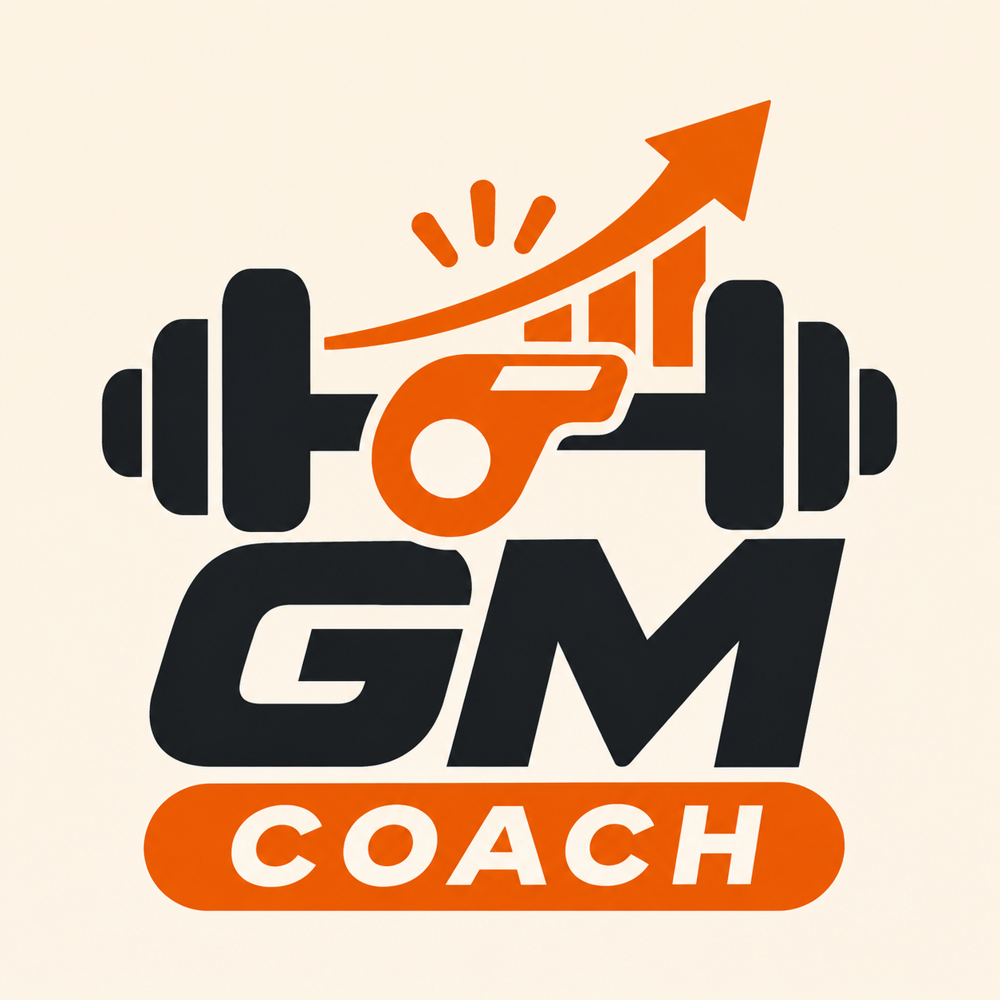
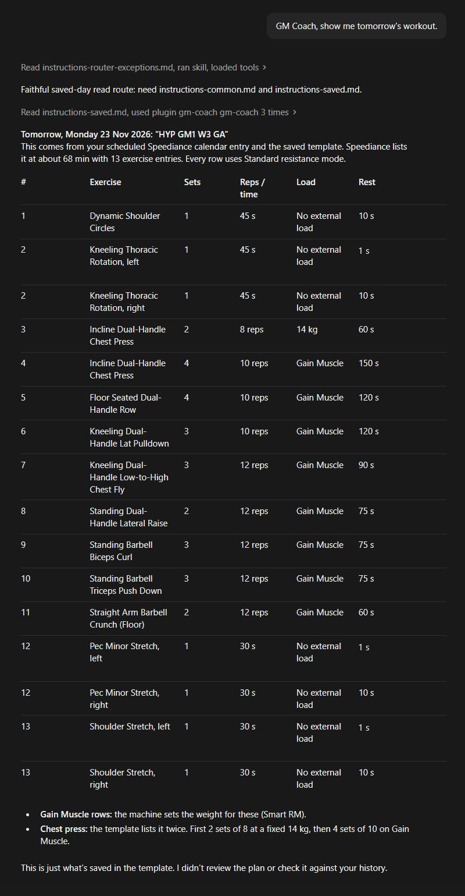
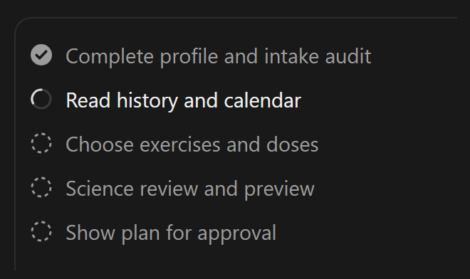
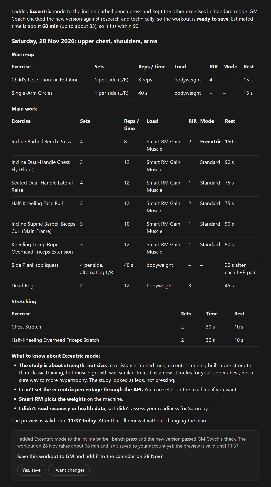

<p align="center">
  
</p>

<h1 align="center">GM Coach</h1>

<p align="center">
  Plugin trenera AI dla Speediance Gym Monster (GM1 i GM2). Planuje trening siłowy w Codex, ChatGPT i Claude na podstawie historii Twoich treningów i aktualnych badań.
</p>

<p align="center">
  <a href="README.md">English</a> · <b>Polski</b>
</p>

<p align="center">
  <a href="https://github.com/gmcoach-plugin/gmcoach/releases/latest"></a>
  <a href="LICENSE"></a>
  <a href="https://ko-fi.com/gmcoach"></a>
</p>

<p align="center">
  
</p>

## Funkcje

### Planowanie

- **Plany treningowe:** tworzy programy Gym Monster: siłowe, czasowe i cardio, wyłącznie z ćwiczeń i akcesoriów, które potwierdzisz, razem z dopasowaną rozgrzewką i rozciąganiem.
- **Cykle wielotygodniowe:** planuje progresję i deload tydzień po tygodniu, z datami, i zapisuje cały cykl po jednym zatwierdzeniu.
- **Smart RM i tryby oporu:** korzysta z presetów Gain Muscle, Stamina i Strength oraz trybów Standard, Chain i Eccentric albo ze stałego ciężaru dobranego na podstawie Twojego 1RM.
- **Edycja zapisanych treningów:** zmienia przerwy, tryb oporu, ciężar lub kolejność ćwiczeń i przed zapisem pokazuje różnice.
- **Kalendarz:** odczytuje kalendarz Speediance i dodaje zapisane treningi do wybranych dni.
- **Czas sesji:** szacuje długość treningu i dopasowuje plan do czasu, którym dysponujesz.

### Analiza i regeneracja

- **Historia treningów:** odczytuje ukończone sesje z seriami, obciążeniami, tętnem, danymi z wioślarza i statystykami okresu.
- **Porównanie sesji:** porównuje dwie ukończone sesje seria po serii.
- **Dane o regeneracji:** odczytuje raporty zdrowotne Speediance, takie jak sen, HRV, zmęczenie i obciążenie mięśni, za Twoją zgodą.

### Indywidualne prowadzenie

- **Profil treningowy:** krótki wywiad zapisuje lokalnie Twoje cele, preferencje i ograniczenia.
- **Plany z uwzględnieniem kontuzji:** bierze pod uwagę zgłoszone ograniczenia ruchowe.
- **Sprzęt:** sprawdza Twoje akcesoria i wymagania każdego ćwiczenia oraz przeszukuje katalog ćwiczeń Gym Monster.
- **Decyzje oparte na badaniach:** przeszukuje PubMed i łączy decyzje w planie z prawdziwymi źródłami.

### Więcej

- **Oficjalne treści:** przegląda oficjalne treningi i programy Speediance.
- **Udostępnianie i import planów:** eksportuje plan lub zapisany trening do pliku oraz importuje udostępnione plany i treningi z plików JSON. Przed zapisem sprawdza każde ćwiczenie i dawkę.
- **Szybki trening testowy:** tworzy jednorazową sesję testową, żeby wypróbować ćwiczenie lub ustawienie.
- **Kilka kont:** obsługuje kilka profili Speediance na jednym komputerze.
- **Limit szablonów:** wykrywa pełną listę szablonów i proponuje usunięcie nieużywanych, wyłącznie za Twoją zgodą.
- **Diagnostyka:** sprawdza wersję pluginu i połączenie z kontem Speediance.

### Bezpieczeństwo i prywatność

- **Bezpieczny zapis:** pokazuje pełny podgląd planu i zapisuje go na koncie dopiero po Twoim wyraźnym potwierdzeniu.
- **Przerwany zapis:** jeśli zapis zostanie przerwany, GM Coach przed ponowną próbą sprawdza konto, co chroni przed zdublowaniem treningu. Cykl wielotygodniowy jest kontynuowany od miejsca przerwania.
- **Pamięć lokalna:** zapamiętuje informacje, o które poprosisz, na przykład sprzęt albo preferencje, i usuwa je na Twoje życzenie.
- **Lokalnie i prywatnie:** działa na Twoim komputerze, a hasło Speediance zostaje w systemowym magazynie haseł.

## Jak to działa

GM Coach przechodzi przez kolejne kroki i pokazuje postęp podczas przygotowywania planu:

<p align="center">
  
</p>

Gdy plan jest gotowy, GM Coach pokazuje cały trening, wyjaśnia swoje wybory i przed zapisem czeka na Twoją zgodę:

<p align="center">
  
</p>

## Obsługiwane aplikacje

| Aplikacja | System | Instrukcja instalacji |
|---|---|---|
| Codex (opcjonalnie ChatGPT przez bezpieczny tunel) | Windows; macOS i Linux eksperymentalnie | [Polski](installer/codex/README-INSTALACJA.md) · [English](installer/codex/README-INSTALL-EN.md) |
| Claude (aplikacja i Claude Code) | Windows; macOS i Linux eksperymentalnie | [Polski](installer/claude/README-CLAUDE.md) · [English](installer/claude/README-CLAUDE-EN.md) |

## Szybki start

1. Pobierz instalator dla swojej aplikacji z [najnowszego wydania](https://github.com/gmcoach-plugin/gmcoach/releases/latest).
2. Opcjonalnie porównaj sumę SHA-256 pliku z sumą widoczną w wydaniu.
3. Rozpakuj całe archiwum i uruchom `START-WINDOWS.cmd` (Codex) albo `START-CLAUDE-WINDOWS.cmd` (Claude).
4. Otwórz nowy czat i napisz: *„GM Coach, pomóż mi połączyć moje konto Speediance”.*

Potrzebujesz konta Speediance i urządzenia Gym Monster. Instalację na macOS i Linux, aktualizację oraz odinstalowanie opisuje instrukcja instalacji.

**Sprawdzone urządzenia:** Gym Monster **GM1** i **GM2**.

## Instalacja ręczna (dla zaawansowanych)

Wybierz ten sposób, jeśli wolisz zainstalować GM Coach jako zwykły plugin, bez instalatora. Możesz też poprosić Codex albo Claude Code, żeby wykonał te kroki za Ciebie.

### 1. Przygotuj folder pluginu

Potrzebujesz **Node.js 24** ([nodejs.org](https://nodejs.org)) i kodu źródłowego z [najnowszego wydania](https://github.com/gmcoach-plugin/gmcoach/releases/latest).

1. Skopiuj folder `plugin` z repozytorium do `~/.codex/plugins/gm-coach`. Z tego folderu mogą korzystać zarówno Codex, jak i Claude.

   ```powershell
   # Windows (PowerShell)
   Copy-Item -Recurse .\plugin "$env:USERPROFILE\.codex\plugins\gm-coach"
   ```

   ```bash
   # macOS / Linux
   mkdir -p ~/.codex/plugins && cp -R plugin ~/.codex/plugins/gm-coach
   ```

2. Pobierz `speediance-cli` dla swojego systemu ze [strony wydań programu](https://github.com/stozo04/speediance-cli/releases/latest) i umieść go w podfolderze `bin` (`bin\speediance-cli.exe` na Windows, `bin/speediance-cli` na macOS i Linuksie). Na macOS i Linuksie wykonaj `chmod +x bin/speediance-cli`.

3. W folderze pluginu zainstaluj moduł magazynu haseł dla swojego systemu:

   ```powershell
   # Windows
   node scripts/install-keyring-runtime.mjs --root . --platform win32 --arch x64
   ```

   ```bash
   # macOS (Apple Silicon; na Intelu użyj --arch x64)
   node scripts/install-keyring-runtime.mjs --root . --platform darwin --arch arm64
   # Linux (na ARM użyj --arch arm64, na Alpine --libc musl)
   node scripts/install-keyring-runtime.mjs --root . --platform linux --arch x64 --libc gnu
   ```

### 2a. Dodaj plugin do Codexa

1. Otwórz `~/.agents/plugins/marketplace.json` (utwórz go, jeśli nie istnieje) i dodaj GM Coach do listy `plugins`:

   ```json
   {
     "name": "personal",
     "interface": { "displayName": "Personal" },
     "plugins": [
       {
         "name": "gm-coach",
         "source": { "source": "local", "path": "./.codex/plugins/gm-coach" },
         "policy": { "installation": "AVAILABLE", "authentication": "ON_INSTALL" },
         "category": "Health & Fitness"
       }
     ]
   }
   ```

2. Uruchom `codex plugin add gm-coach@personal` albo w Codexie otwórz listę pluginów, wybierz **Personal**, a potem **GM Coach** i go włącz.
3. Uruchom Codex ponownie.

### 2b. Dodaj plugin do Claude

**Claude Code** (Windows, macOS i Linux):

```powershell
# Windows
claude mcp add --scope user gm-coach -- node "$env:USERPROFILE\.codex\plugins\gm-coach\mcp_server.mjs"
```

```bash
# macOS / Linux
claude mcp add --scope user gm-coach -- node "$HOME/.codex/plugins/gm-coach/mcp_server.mjs"
```

**Claude Desktop** (Windows i macOS): dodaj GM Coach do pliku `claude_desktop_config.json` (Windows: `%APPDATA%\Claude\`, macOS: `~/Library/Application Support/Claude/`), podając pełną ścieżkę do `mcp_server.mjs`, a potem uruchom Claude ponownie:

```json
{
  "mcpServers": {
    "gm-coach": { "command": "node", "args": ["/pelna/sciezka/do/.codex/plugins/gm-coach/mcp_server.mjs"] }
  }
}
```

Potem otwórz nowy czat i napisz: *„GM Coach, pomóż mi połączyć moje konto Speediance”.* Aby zaktualizować plugin, zastąp jego folder nową wersją i uruchom aplikację ponownie. Konto i profil treningowy zostaną zachowane.

## Prywatność i bezpieczeństwo

- Hasło Speediance jest przechowywane wyłącznie w systemowym magazynie poświadczeń: Menedżerze poświadczeń Windows, Pęku kluczy macOS albo Secret Service na Linuksie. Nie podawaj go w czacie.
- Plugin odczytuje historię i zmienia dane na koncie tylko po Twojej zgodzie w rozmowie.
- Jeśli instalator pobiera zależności, robi to z oficjalnych źródeł i sprawdza ich sumy kontrolne.

## Zgłaszanie błędów i propozycji

Skorzystaj z [GitHub Issues](https://github.com/gmcoach-plugin/gmcoach/issues/new/choose). Podaj wersję pluginu z lokalnej diagnostyki i nie wklejaj haseł, adresów e-mail, tokenów ani kluczy.

## Wsparcie projektu

GM Coach jest darmowy. Jeśli pomaga Ci w treningu, możesz [wesprzeć go na Ko-fi](https://ko-fi.com/gmcoach).

## Licencja

Projekt jest udostępniony na [licencji MIT](LICENSE).

## Zastrzeżenia

GM Coach to niezależny projekt, niepowiązany ze Speediance, nieautoryzowany ani niesponsorowany przez tę firmę. Gym Monster i Speediance są znakami towarowymi ich właścicieli. Sugestie treningowe nie zastępują porady wykwalifikowanego trenera ani lekarza.
